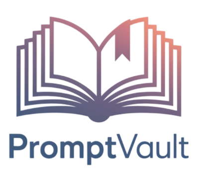
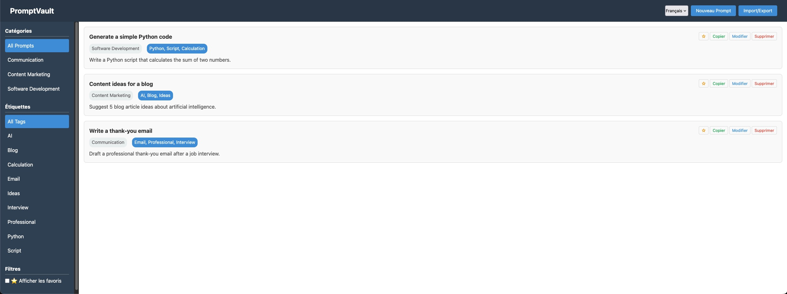

<h1 align="center">
  <a href="https://codeberg.org/medenor/promptvault">
    
  </a>
</h1>

<div align="center">
  PromptVault
  <br />
  <a href="#about"><strong>Explore the screenshots »</strong></a>
  <br />
  <br />
  <a href="https://codeberg.org/medenor/promptvault/issues/new?assignees=&labels=bug&template=01_BUG_REPORT.md&title=bug%3A+">Report a Bug</a>
  ·
  <a href="https://codeberg.org/medenor/promptvault/issues/new?assignees=&labels=enhancement&template=02_FEATURE_REQUEST.md&title=feat%3A+">Request a Feature</a>
  ·
  <a href="https://codeberg.org/medenor/promptvault/issues/new?assignees=&labels=question&template=04_SUPPORT_QUESTION.md&title=support%3A+">Ask a Question</a>
</div>

<div align="center">
<br />

<a href="https://www.gnu.org/licenses/agpl-3.0">
  
</a>
<a href="https://www.python.org/">
  
</a>
<a href="https://fastapi.tiangolo.com/">
  
</a>
<a href="https://www.docker.com/">
  
</a>
<a href="https://docs.pytest.org/">
  
</a>
<a href="https://github.com/psf/black">
  
</a>
<a href="https://codeberg.org/medenor/promptvault/issues">
  
</a>
<a href="https://codeberg.org/medenor/promptvault/">
  
</a>
<a href="https://codeberg.org/medenor">
  
</a>
</div>

<details open="open">
<summary>Table of Contents</summary>

- [About](#about)
  - [Built With](#built-with)
  - [Version Control](#version-control)
- [Getting Started](#getting-started)
  - [Prerequisites](#prerequisites)
  - [Installation](#installation)
- [Usage](#usage)
- [Roadmap](#roadmap)
- [Support](#support)
- [Project assistance](#project-assistance)
- [Contributing](#contributing)
- [Authors & contributors](#authors--contributors)
- [Security](#security)
- [License](#license)
- [Acknowledgements](#acknowledgements)

</details>

---

## About

PromptVault is a modern web-based prompt management application designed to help users easily organize, store, and retrieve their prompts for various AI applications, software development, content marketing, and much more. Whether you are a developer, writer, marketer, or simply a user of AI-based tools, PromptVault allows you to centralize your prompts and improve your productivity through a responsive web interface accessible from any browser.

### Built With

- [Python](https://www.python.org/) 3.11+
- [FastAPI](https://fastapi.tiangolo.com/) - Modern web framework
- [Uvicorn](https://www.uvicorn.org/) - High-performance ASGI server
- [Jinja2](https://jinja.palletsprojects.com/) - Template engine
- [SQLAlchemy](https://www.sqlalchemy.org/) - Database ORM
- [PostgreSQL](https://www.postgresql.org/) / [SQLite](https://www.sqlite.org/) - Database backends
- [Alembic](https://alembic.sqlalchemy.org/) - Database migrations
- [Docker](https://www.docker.com/) - Containerization platform

### Architecture

PromptVault follows a clean, layered architecture with clear separation of concerns:

**Service Layer:**

- **PromptDataService**: Handles all data-related operations including loading, saving, and migration of prompt data
- **PromptFilterService**: Manages filtering and searching logic for prompts
- **PromptVersioningService**: Handles version control operations for prompts
- **PromptImportExportService**: Manages import and export operations in various formats (CSV, Markdown)
- **BackupService**: Provides comprehensive data backup and restoration capabilities with automatic pre-operation backups

**Data Layer (Database Backend):**

- **Repository Pattern**: Abstract data access through specialized repositories (PromptRepository, VersionRepository, CategoryRepository, TagRepository)
- **ORM Models**: SQLAlchemy models for type-safe database operations
- **Session Management**: Context managers for transaction safety and automatic rollback
- **Migration Support**: Alembic-based database versioning and schema evolution

**Storage Options:**

- **PostgreSQL**: Production-ready relational database for high-performance, concurrent access (recommended for production)
- **SQLite**: Lightweight embedded database for development and small deployments
- **JSON (Legacy)**: File-based storage for backward compatibility (deprecated)

This modular design improves code maintainability, testability, and extensibility while providing flexibility in deployment options.

For detailed technical specifications and database schema, see [Database Specification](docs/SPECS/SPEC_DATABASE.md). For development guidelines and codebase structure, see [AGENTS.md](docs/AGENTS.md).

### Version Control

PromptVault includes a robust, Git-like version control system for all prompts, ensuring full traceability and a clear history of changes. This feature is **fully implemented and production-ready**. Key features include:

- **Automatic Versioning**: Every update to a prompt automatically creates a new version with complete metadata
- **Unique Version Identifiers**: Each prompt version is assigned a UUID for reliable tracking
- **Detailed Metadata**: Every version tracks essential metadata including timestamp, author, and commit message
- **Version History View**: A dedicated modal dialog allows users to browse a prompt's complete version history with all commits and details
- **Diff Visualization**: Easily compare any two versions to see precise changes in prompt content, title, category, and tags with color-coded highlighting
- **Revert Functionality**: Users can safely revert a prompt to any previous version, which creates a new commit reflecting the reverted state (history is never lost)
- **Keyboard Shortcuts**: Quick access with Cmd+H (Mac) or Ctrl+H (Windows/Linux) to open version history
- **Multi-language Support**: Version control UI available in English, French, Spanish, and German

For detailed usage instructions, see [Version Control Documentation](docs/VERSION_CONTROL.md).

### Data Backup System

PromptVault includes a comprehensive, production-ready backup system to prevent data loss and enable easy recovery:

- **Automatic Backups**: Pre-operation backups are created automatically before risky operations (delete prompts, replace imports)
- **Manual Backups**: Users can create custom-named backups at any time through the web interface
- **Backup Management**: Full-featured backup management page (`/backup-management`) for viewing, restoring, and managing all backups
- **Smart Retention**: Configurable cleanup policies to remove old backups and save disk space
- **Compression**: Automatic gzip compression of older backups to optimize storage usage
- **Safety Features**: Pre-restore backups ensure no data loss during restoration operations
- **Complete Metadata**: Every backup includes comprehensive metadata (timestamp, size, prompt count, author)
- **Maintenance Tools**: Built-in cleanup and compression utilities with progress indicators
- **Statistics Dashboard**: Real-time backup statistics and storage information

<details>
<summary>Screenshots</summary>
<br>

<div align="center">

### Main Interface



### Import/Export Management


### Prompt Editor


</div>
</details>

## Getting Started

### Prerequisites

- Python 3.11+
- PostgreSQL 15+ (for production) or SQLite 3.x (for development)
- Docker and Docker Compose (recommended for production deployment)

### Quick Start with Docker Compose

The fastest way to get started with full database support:

```bash
# Clone repository
git clone https://codeberg.org/medenor/promptvault.git
cd PromptVault

# Configure environment
cp .env.example .env
# Edit .env and set POSTGRES_PASSWORD

# Start services (PostgreSQL + PromptVault)
docker-compose up -d

# Run database migrations
docker-compose exec web alembic upgrade head

# (Optional) Migrate existing JSON data
docker-compose exec web python scripts/migrate_json_to_db.py
```

Then open your browser to `http://localhost:8001`

### Additional Installation Options

For detailed deployment instructions including manual installation, environment configuration, and production setup, see:

- **[Deployment Guide](docs/DEPLOYMENT.md)** - Complete deployment instructions for Docker, Docker Compose, and manual deployment
- **[Migration Guide](docs/MIGRATION_GUIDE.md)** - Step-by-step guide for migrating from JSON to database storage
- **[Database Specification](docs/SPECS/SPEC_DATABASE.md)** - Technical specification and architecture details

## Usage

### Web Application (Recommended)

PromptVault is primarily a web-based application that runs in your browser and can be deployed as a Docker container.

#### Running with Docker (Production)

```bash
docker-compose up --build
```

Open your browser and go to `http://localhost:8001`

#### Running Locally (Development)

1. Install dependencies:

```bash
pip install -e .
```

2. Run the web application:

```bash
python3 run_web.py
```

By default, the application will run on port 8003. To use a different port, set the `PORT` environment variable:

```bash
PORT=8001 python3 run_web.py
```

3. Open your browser and go to `http://localhost:8003` (or the port you specified)

4. To stop the web application, press `Ctrl+C` in the terminal where the server is running

**Note:** PromptVault is now a web-only application. The legacy desktop version has been deprecated and its startup scripts removed.

### Features

- **Prompt Management**: Create, edit, delete, and organize prompts through an intuitive web interface
- **Bulk Operations**: Multi-select prompts with checkboxes and delete multiple prompts in a single operation with automatic backups
- **Version Control**: Git-like versioning system with full history tracking, diff visualization, and safe revert functionality
- **Categories & Tags**: Organize prompts with categories and tags for easy discovery
- **Search & Filter**: Find prompts quickly with advanced filtering and search capabilities
- **Import/Export**: Support for CSV, Markdown, and JSON formats with preview functionality
- **Data Backup System**: Comprehensive backup and restoration with automatic pre-operation backups, manual backups, cleanup, and compression
- **Responsive Design**: Modern, mobile-friendly interface that works on all devices
- **Multi-language Support**: Internationalization with English, French, Spanish, and German
- **Validation & Monitoring**: End-to-end validation/sanitization across API, server, and client with `/api/validation/stats` metrics (see below)

### Internationalization

PromptVault supports multiple languages (English, French, Spanish, German). The application will automatically detect your system language, but you can also change languages from the language selector in the header.

**Translation Files:**

- Web interface uses JSON translation files in `src/web/static/locales/`
- Translations are loaded dynamically using i18next

### Validation & Monitoring

PromptVault ships with an end-to-end input validation and sanitization framework:

- **API contracts**: All POST/PUT endpoints use Pydantic schemas with length, pattern, and enum constraints (prompts, export/import, backups, version revert).
- **Server sanitization**: Safe filename/backup handling, upload MIME/size checks, control-character stripping, whitespace normalization, tag deduplication.
- **Client parity**: Real-time validation, character counters, duplicate-tag warnings, ARIA/i18n (en/fr/es/de), suppression of native browser prompts.
- **Monitoring**: Validation metrics persisted to `data/logs/validation_metrics.json` and exposed via `GET /api/validation/stats` (success/failure counts, per-endpoint breakdown, recent failures, failure_rate).

See `docs/API_VALIDATION_AND_MONITORING.md` and `docs/VALIDATION_TEST_CHECKLIST.md` for usage and test steps.

### Project Structure

PromptVault follows a clean, layered architecture:

- **`src/web/`** - FastAPI web application, templates, and static assets
- **`src/services/`** - Business logic layer (data services, filtering, versioning, import/export, backups)
- **`src/db/`** - Database layer with SQLAlchemy models and repositories
- **`scripts/`** - Utility scripts (database migration, operations testing)
- **`alembic/`** - Database migration version control
- **`data/`** - Application data (database, backups, logs)
- **`tests/`** - Comprehensive test suite (509 tests, 86.90% coverage)
- **`docs/`** - Documentation and specifications

For detailed project structure and development guidelines, see [AGENTS.md](docs/AGENTS.md).

## Testing

PromptVault includes a comprehensive pytest suite with **509 passing tests** and **86.90% code coverage**.

### Quick Start

```bash
# Install test dependencies
pip install -e .[test]

# Run full suite with coverage
pytest

# Run specific test files
pytest tests/test_db_repositories.py
pytest tests/test_db_services.py
pytest tests/test_version_system.py

# Skip performance tests
pytest -m "not performance"
```

The test suite uses in-memory SQLite for fast, isolated testing and completes in ~8 seconds.

### Comprehensive Testing Documentation

For detailed information about the test suite architecture, fixtures, coverage requirements, and CI/CD recommendations, see **[TESTING.md](docs/TESTING.md)**.

## Observability & Telemetry

- **Structured Logs**: Application and audit logs live in `data/logs/` as newline-delimited JSON. Use tools like `jq` (`tail -f data/logs/audit.log | jq '.action,.resource_id'`) when troubleshooting in development.
- **Frontend Reporter**: `src/web/static/js/telemetry.js` registers a global `window.FrontendLogger`. Call `window.FrontendLogger.reportError('component', 'action', error, { extra: 'context' });` to capture handled failures. All payloads are sanitized (strings truncated to 500–2,000 chars) and rate limited (10 reports per client IP per minute).
- **Opt-out Controls**: Developers/testers can disable reporting via `window.FrontendLogger.disable()` or by setting `localStorage.setItem('promptvault.telemetry.optOut', 'true')`. Call `window.FrontendLogger.enable()` to re-enable. The reporter only sends when enabled and still logs to the browser console for debugging.
- **Server Endpoint**: The `/api/logs/frontend` route receives telemetry, enriches it with the caller IP/request metadata, and stores it through the same logging infrastructure so alerts/exports see both backend and frontend failures.

## Roadmap

For a comprehensive feature improvement roadmap with detailed implementation plans, see [ROADMAP.md](ROADMAP.md).

### Completed Features

- [x] **Version Control System:** Git-like versioning with history tracking, diff visualization, and revert functionality
- [x] **Search & Filtering:** Advanced searching and filtering capabilities across all prompts
- [x] **Data Backup System:** Comprehensive backup and restoration with automatic pre-operation backups, manual backups, cleanup, and compression
- [x] **Unit Tests:** Comprehensive test coverage (85%+) for core functionality with performance benchmarks
- [x] **Database Migration:** Complete transition from JSON to SQLite/PostgreSQL with backward compatibility (see [Migration Guide](docs/MIGRATION_GUIDE.md))
- [x] **Docker & Deployment:** Production-ready Docker setup with PostgreSQL integration and health checks (see [Deployment Guide](docs/DEPLOYMENT.md))

### Phase 1: Foundation Strengthening (Priority: High)

- [x] **Input Validation & Sanitization:** Comprehensive validation framework preventing injection attacks and ensuring data integrity
- [x] **Error Handling & Logging:** Centralized logging infrastructure with structured logs and audit trails
- [x] **Database Backend:** SQLAlchemy ORM with repository pattern, Alembic migrations, and PostgreSQL/SQLite support
- [ ] **Performance Monitoring:** Real-time monitoring with APM, error tracking, and analytics dashboards
- [ ] **Accessibility Compliance:** WCAG 2.1 AA compliance with full keyboard navigation and screen reader support

### Phase 2: Security & Architecture (Priority: High)

- [ ] **Authentication & Authorization:** User management with JWT tokens and role-based access control
- [ ] **TypeScript Migration:** Convert frontend to TypeScript for type safety and better developer experience
- [ ] **API Documentation:** Interactive OpenAPI/Swagger documentation with client SDKs
- [ ] **Full-Text Search:** PostgreSQL FTS for advanced search capabilities with ranking and relevance scoring

### Phase 3: User Experience (Priority: Medium)

- [ ] **Pagination & Lazy Loading:** Server-side pagination for handling large datasets efficiently
- [ ] **Advanced Search:** Full-text search, fuzzy matching, saved searches, and advanced filters
- [ ] **Tag & Category Management:** Dedicated interface for managing taxonomy with merge and bulk operations
- [ ] **Mobile UI Enhancements:** Touch-optimized controls, offline support, and mobile-friendly gestures

### Phase 4: Collaboration & Integration (Priority: Medium)

- [ ] **Collaborative Editing:** Real-time updates with WebSockets, presence indicators, and conflict resolution
- [ ] **Enhanced Backup System:** Scheduled backups, cloud storage integration, incremental backups, and encryption
- [ ] **Export & Sharing:** PDF/HTML export, public sharing links, and integrations (Notion, Confluence, Slack)

See [ROADMAP.md](ROADMAP.md) for detailed task breakdowns, implementation estimates, and success metrics.

For proposed features and known issues, visit the [open issues](https://codeberg.org/medenor/promptvault/issues) page.

## Support

Reach out to the maintainer at one of the following places:

- [Codeberg issues](https://codeberg.org/medenor/promptvault/issues)
- Contact options listed on [this Codeberg profile](https://codeberg.org/medenor)

## Project assistance

If you want to say **thank you** or/and support active development of PromptVault:

- Add a [Star](https://codeberg.org/medenor/promptvault) to the project.
- Write interesting articles about the project on [Dev.to](https://dev.to/), [Medium](https://medium.com/) or your personal blog.

Together, we can make PromptVault **better**!

## Contributing

First off, thanks for taking the time to contribute! Contributions are what make the open-source community such an amazing place to learn, inspire, and create. Any contributions you make will benefit everybody else and are **greatly appreciated**.

Please read our contribution guidelines, and thank you for being involved!

## Authors & contributors

The original setup of this repository is by [Medenor](https://codeberg.org/medenor).

For a full list of all authors and contributors, see [the contributors page](https://codeberg.org/medenor/promptvault/graphs/contributors).

## Security

PromptVault follows good practices of security, but 100% security cannot be assured.
PromptVault is provided **"as is"** without any **warranty**. Use at your own risk.

## License

This project is licensed under the **GNU AGPLv3 license**.

See [LICENSE](LICENSE) for more information.

## Acknowledgements

- Repository files templates provided by [dec0dOS/amazing-github-template](https://github.com/dec0dOS/amazing-github-template)
- Repository icon: [Reading icons created by Freepik - Flaticon](https://www.flaticon.com/free-icons/reading)
