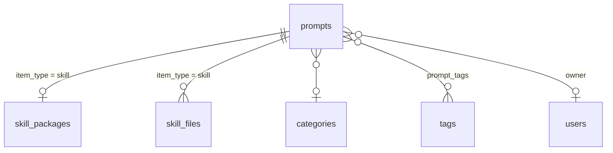
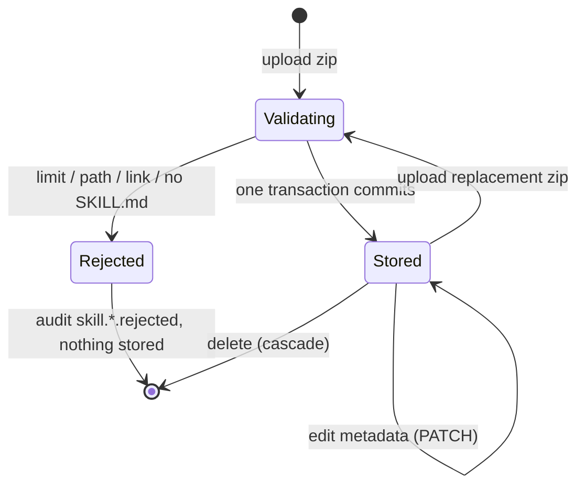

# Data Model: Skill Packages

**Feature**: 011-skill-packages | **Date**: 2026-11-12

The design reasons are in [research.md](research.md), Decisions 1, 2 and 5.

## Changed table: `prompts`

| Column | Type | Rule |
|---|---|---|
| `item_type` *(new)* | `VARCHAR(16)` NOT NULL, server default `'prompt'`, indexed (`idx_prompts_item_type`) | `CHECK (item_type IN ('prompt', 'skill'))` |

Existing columns, as used by a skill:

| Column | For a skill |
|---|---|
| `title` | Set from the frontmatter `name` at first import, or from the archive name if `name` is missing. Editable afterwards and kept when the files are replaced. Cut to 200 characters. |
| `prompt` | The full `SKILL.md` text decoded as UTF-8, frontmatter included. Read-only for skills. Updated only by import or replacement. Feeds full-text search (FR-024). It is not held to the 50,000-character limit that prompt requests enforce (`src/web/models/requests.py`). It is capped instead by `SKILL_MAX_SKILL_MD_BYTES` (1 MB). Skill rows must never be validated against the prompt request models: the guards in research.md Decision 7 keep them out of every prompt write path. |
| `note`, `favorite`, `category_id`, tags | Same as for prompts (FR-021) |
| `user_id` | The user who imported the skill. In anonymous mode, the default user. |
| `legacy_public` | Always `false` for skills |
| `semantic_version` | Always null for skills |
| `versions`, `branches`, `shares` | Always empty for skills (guarded, see research.md Decision 7) |

## New table: `skill_packages` (one row per skill)

| Column | Type | Rule |
|---|---|---|
| `prompt_id` | `INTEGER` PK, FK → `prompts.id` `ON DELETE CASCADE` | The parent row must have `item_type = 'skill'` (checked in the service) |
| `skill_identifier` | `VARCHAR(64)` NOT NULL, indexed | Matches `^[a-z0-9]+(-[a-z0-9]+)*$`. Not unique. Recalculated on replacement (FR-012a). |
| `description` | `TEXT` NULL | From the frontmatter `description`, kept as written (not cut to 1,024 characters; too-long values only produce a warning) |
| `total_bytes` | `BIGINT` NOT NULL | Sum of `skill_files.size` |
| `file_count` | `INTEGER` NOT NULL | Count of `skill_files` rows |
| `format_warnings` | `JSON` NOT NULL, default `[]` | List of warning codes (research.md Decision 4). Empty means the skill fully follows the format. |
| `source_archive_name` | `VARCHAR(255)` NOT NULL | File name of the most recent upload, used for audit and as a fallback |
| `files_updated_at` | `TIMESTAMPTZ` NOT NULL | Time of the last import or replacement. Used as the fixed timestamp of export entries. |

## New table: `skill_files` (one row per file)

| Column | Type | Rule |
|---|---|---|
| `id` | `INTEGER` PK autoincrement | |
| `prompt_id` | `INTEGER` NOT NULL, FK → `prompts.id` `ON DELETE CASCADE`, indexed | |
| `path` | `VARCHAR(1024)` NOT NULL | Relative to the skill root, separated by `/`, NFC-normalised, no leading `/`, no `.` or `..` segments, at most `SKILL_MAX_DEPTH` levels |
| `path_folded` | `VARCHAR(1024)` NOT NULL | `path.casefold()`, used to enforce uniqueness regardless of letter case |
| `size` | `BIGINT` NOT NULL | Length of `content` in bytes |
| `sha256` | `CHAR(64)` NOT NULL | Lowercase hex of `content`. Lets export and restore integrity be checked (SC-002, SC-006). |
| `is_text` | `BOOLEAN` NOT NULL | No NUL byte and valid UTF-8 (research.md Decision 10). Server default `sa.false()`. |
| `content` | `LargeBinary` NOT NULL (`BYTEA` / `BLOB`) | The exact bytes from the archive |

**Constraints**: `UNIQUE (prompt_id, path_folded)`, which enforces the duplicate and case-collision rule (FR-007) at the database level as well as in the reader.

**Loading**: the list and metadata queries never select `content`. It is loaded only for a single file read, a download or an export, using `defer()` or explicit column lists.

## Invariants (enforced in `SkillService`)

1. Exactly one `skill_files` row has `path = 'SKILL.md'` (the entry point).
2. `skill_packages.file_count = COUNT(skill_files)` and `total_bytes = SUM(size)`. Both are updated in the same transaction as the files.
3. Import inserts the `prompts`, `skill_packages` and `skill_files` rows in one transaction (FR-010).
4. Replacement, in one transaction (FR-022): delete the old `skill_files` rows, insert the new ones, update `skill_packages`, and set `prompts.prompt` to the new `SKILL.md` text. `prompts.title`, `note`, `favorite`, `category_id` and tags are left unchanged.
5. Delete: removing the `prompts` row cascades to `skill_packages` and `skill_files` (FR-023).

## Lifecycle

A rejected replacement leaves the skill in its previous `Stored` state, unchanged (FR-022, Story 4 scenario 5).

## Migration `d4e5f6a7b8c9_add_skill_packages`

- `down_revision = 'd80fb5792dda'` (009 TOTP 2FA, the current Alembic head). Re-check `alembic heads` immediately before creating the migration; if a later migration has merged, use that sole head instead.
- Follows the rules in `docs/agents/python-style.md`:
  - checks for existing tables and columns with `sa.inspect(conn)`;
  - adds the column with `op.add_column('prompts', sa.Column('item_type', sa.String(16), nullable=False, server_default='prompt'))`;
  - adds the check constraint and index through `op.batch_alter_table` for SQLite;
  - creates both new tables with `op.create_table`;
  - uses `sa.false()` for boolean defaults.
- The full-text triggers and the generated `search_vector` column from 008 are left alone, because the skill text sits in the already-indexed `prompt` column.
- The downgrade drops both tables, then the index, the check constraint and the column. It refuses to run if any `item_type = 'skill'` rows exist (raises with a clear message), so that skills are not silently turned into prompts.
- Tested on SQLite and on a local PostgreSQL container before merging.
